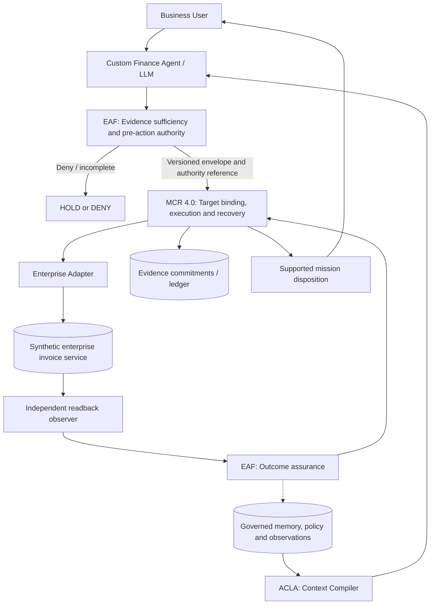

# When a Custom AI Agent Meets an Enterprise System: ACLA → EAF → MCR 4.0 → Verified Business Data

**Prasad Deshpande** — Independent research, enterprise AI architecture  
**Date:** 26 October 2026 · **Status:** Public-safe article candidate; not a qualified integration or peer-reviewed release.

The interesting part of an enterprise AI agent often starts after the language model understands the business request. The model might know which API to call and might even generate a correct-looking response. The enterprise system still needs a valid identity, a permitted operation, a transaction against the intended object, and reliable evidence of what changed.

That is the interaction I want to explore through **ACLA → EAF → MCR 4.0 → Enterprise Adapter → Enterprise System → Independent Readback**. Rather than describe each research component independently, consider one custom agent completing one business request.

## The request: review a finance invoice

Imagine a custom Finance Invoice Review Agent receiving: “Review invoice INV-1007 and, if it is eligible, mark it as reviewed. Confirm the actual outcome.”

For this proposed POC, the invoice system is a **simulator**, not a live ERP or SAP tenant. The simulator has explicit invoice identities, statuses and versions. The agent has no direct write access. A versioned adapter is the only controlled interface for proposed updates.

Why is this distinction important? An agent might retrieve an invoice, decide it is eligible, invoke an update operation and receive HTTP 200. But that receipt does not necessarily mean the invoice status actually changed. An update could fail at business-validation time, complete asynchronously or commit just before a transport timeout. We need to separate the proposed action from the authority to perform it, and both from the business result.

## ACLA: compile relevant, current mission context

ACLA — Agentic Context Lifecycle Architecture — separates durable memory from the smaller mission-specific information the model should actively consider. For INV-1007 that working set might include current invoice metadata, relevant review policy, the latest observed version, approved operation descriptions and previous observations with provenance.

ACLA decides what evidence is relevant and current enough to present for reasoning. It must not silently promote stale policy or a retrieved document into permission to act. A model with excellent context is still not an authorized transaction executor.

## EAF: evaluate sufficiency, authority and post-action assurance

The agent converts the request into a structured proposal: target INV-1007, operation MARK_REVIEWED, intended resulting state REVIEWED. EAF — Enterprise Agent Framework — evaluates the Minimum Authoritative Working Set (MAWS), checks evidence sufficiency and applies the pre-action policy and authority gates.

If a required field is missing, the evidence conflicts or the action is not authorized, the mission must stop or request authoritative clarification. A model-generated statement saying “approved” is not an approval. Where authority is established, EAF-compatible contracts can supply a versioned execution envelope and authorization reference to the runtime. This describes the intended interoperability architecture; live EAF-to-MCR integration is not yet qualified.

EAF also owns the independent outcome-assurance responsibility after execution. It must assess whether credible observations support the required outcome rather than accepting a tool call's success text as sufficient proof.

## MCR 4.0: deterministic mission execution

MCR — Mission Capability Runtime — binds the authorized mission to an exact operation, intended target and permitted execution context. It enforces execution controls outside the language model: target identity, validity and revocation checks at relevant transitions, call budgets, nonce/replay rules, controlled recovery and evidence commitments.

Suppose the model changes its proposal from INV-1007 to INV-1008 after approval. The new target is not authorized merely because it appears in a later prompt. Suppose execution times out after the simulator committed an update. MCR cannot blindly repeat an operation; it needs reconciliation, fresh applicable authorization and target-system-supported idempotency semantics. If the state cannot be proven, UNKNOWN is more defensible than invented SUCCESS.

The architectural goal is not to make the model perfect. It is to ensure the execution boundary does not depend on the model remembering every safety and transaction rule during every tool call.

## Enterprise adapter: where the business transaction actually happens

The enterprise adapter translates a permitted mission operation into a supported API request. It is responsible for provider-specific capabilities, parameter mapping, technical authentication and transactional behavior. It cannot inherit SAP or other enterprise authorization from a context document, an LLM tool schema or a synthetic research approval.

In the POC, the adapter sends the authorized operation to a simulated invoice service. The simulator performs its own checks and returns an execution receipt. A transport-level 200 response is recorded, but it is **not automatically the final business outcome**. Real enterprise platforms may have additional asynchronous and business-validation semantics.

## Enterprise data: independent readback and closed-loop verification

The architecture then reads the invoice state through a separately defined observation path. The evidence should identify the source, observed object, state and version, and must be protected against substitution or tampering. The observer should not merely echo the execution response it was meant to validate.

There are three useful cases:

- The system-of-record readback confirms INV-1007 is REVIEWED and all outcome conditions are satisfied: the evidence can support SUCCESS.
- The tool responded 200, but the invoice remains PENDING: the requested result has **not** been verified.
- The system cannot be read back after an uncertain timeout: preserve UNKNOWN, reconcile where safe, and never let the model guess at the commit state.

MCR retains the execution history, retry and recovery state, and evidence commitments. EAF performs the independent assurance judgment. Accepted outcome evidence can re-enter the governed context lifecycle so future missions can use it with freshness and provenance constraints. The return path to context is as important as the forward path to execution.

## The architectural closed loop

This is a **proposed integrated reference topology**, not a tested production stack. Its governance principle is `INTEROPERABILITY_DOES_NOT_IMPLY_AUTHORITY`: sharing context, finding tools or presenting approval references does not transfer the authority to act.

## How this changes a custom-agent POC

A meaningful POC should include deliberately failing cases: wrong-target substitution, stale or revoked authorization, transport success without business-state change, timeout after possible commit, unsafe retry, false observer provenance and tampered evidence. It should report rejected or uncertain states, not just count completed tool calls.

For the architect, the measure of quality is whether a mission can establish **what it was allowed to do, what it attempted, what the enterprise system actually recorded and which conclusion the evidence supports**.

## Research status and boundary

MCR 4.0 P1 has been owner-closed as `MCR_R4_0_P1_CLOSED_BOUNDED_SYNTHETIC_RESEARCH`. The executor-supplied R6 receipt reports 131/131 unit tests, 18/18 synthetic scenarios, 22/22 R2 regressions and 40/40 reconciled reviewer tests, plus independent Claude review reporting no blocking findings. The original historical reviewer result of 38/40 and raw-runner exit 1 remain preserved. This publication-preparation session has not independently opened or rehashed the locally held R6 ZIP.

**Not established:** live ACLA/EAF interoperability, Class B adapter qualification, SAP or production execution, generalized exactly-once transactions, public release of private evidence, or peer-reviewed acceptance.

The next engineering step is a separately approved synthetic agent-plus-adapter integration experiment, followed by independent review. Live-system work requires its own authorization and evidence.

I see ACLA, EAF and MCR as complementary controls rather than three competing agent frameworks. ACLA governs the information available for reasoning; EAF assesses evidence and authority; MCR controls execution and recovery; the enterprise system owns business state; and independent observation provides the basis for a credible outcome.

**Research disclosure:** Independent research by Prasad Deshpande. GPT/Codex, Claude, Gemini and private/local LLMs have assisted engineering, analysis, review and writing. Their outputs are not human peer review or production proof. No MCR 4.0 DOI or public release is claimed.

**Research lineages:** [ACLA](https://github.com/askprasaddeshpande-source/agentic-context-lifecycle-architecture) · [EAF](https://github.com/askprasaddeshpande-source/enterprise-agent-framework) · [MCR](https://github.com/askprasaddeshpande-source/mission-capability-runtime)
